# Hidden Camera Detector (Android)

A guided room-inspection toolkit for Android. It helps you check a room using
your phone's camera, magnetometer and your own Wi-Fi network - step by step,
with honest limits. It does **not** automatically detect cameras, and it never
declares a room safe.

## What it does

| Tool | What it helps with | Honest limit |
| --- | --- | --- |
| Lens Glint | Torch + live preview to inspect lens-like reflections | Helps you look; many surfaces reflect. Confirm by hand. |
| IR Light Scan | Look for night-vision IR glow in a dark room | Many phone cameras filter IR; no glow seen is not conclusive. |
| Wi-Fi Devices | List devices on your own network | Only your own network; wired or offline cameras never appear. |
| Magnetic Sensor | Compare magnetic field near objects against a baseline | Speakers and motors cause the same spikes. |

Guided Room Inspection walks through all four checks and builds a report with
clear badges: CHECK (a clue to inspect by hand), NO CLUE (nothing observed,
with limits), REVIEW (identify a device), NOT TESTED (skipped).

## Privacy

Everything runs on the phone. No account, no ads, no tracking, no upload.
Camera preview is never recorded. Network listing works only on the Wi-Fi the
phone is connected to, and only after you confirm you may inspect that network.

## Stack

- Kotlin + Jetpack Compose (Material 3), dark and light themes
- CameraX (preview + torch), Android SensorManager (magnetometer)
- Local subnet sweep + ARP table for own-network device list
- Reports stored locally (SharedPreferences JSON)

## Build

```bash
gradle assembleDebug
# APK: app/build/outputs/apk/debug/app-debug.apk
```

CI builds the APK on every push via GitHub Actions.

## Requirements

- Android 8.0+ (minSdk 26), camera recommended
- Built against Android 15

## Screenshots

Rendered UI verification (Paparazzi) of every screen, dark and light themes.

| Screen | Dark | Light |
| --- | --- | --- |
| Home | 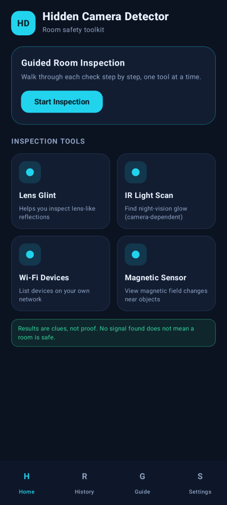 | 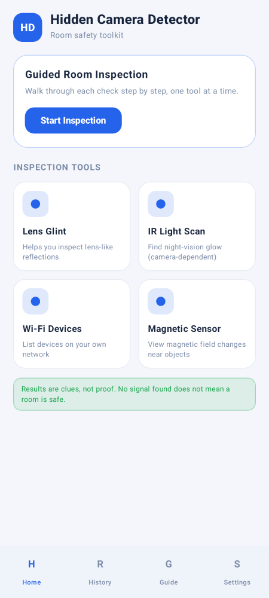 |
| Guided Inspection | 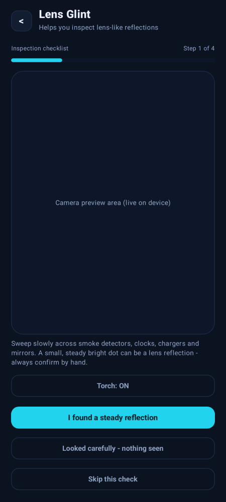 | 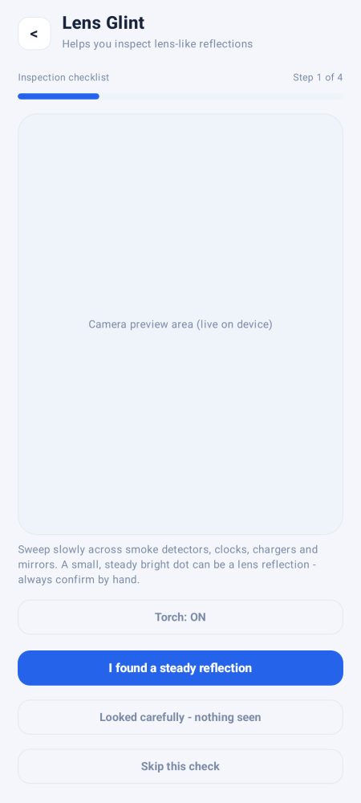 |
| Lens Glint | 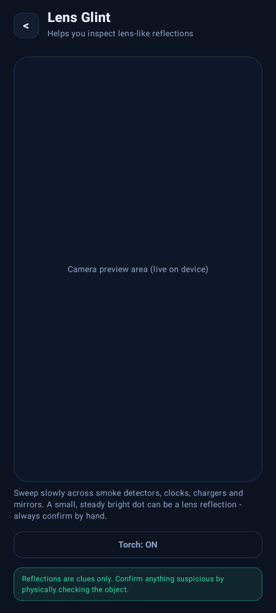 | 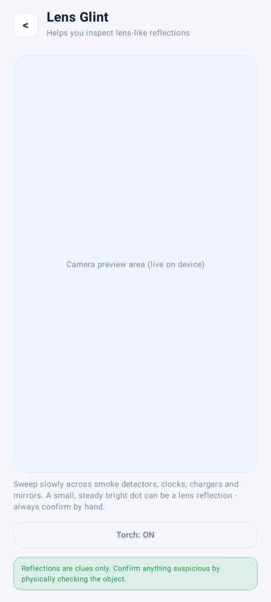 |
| IR Light Scan | 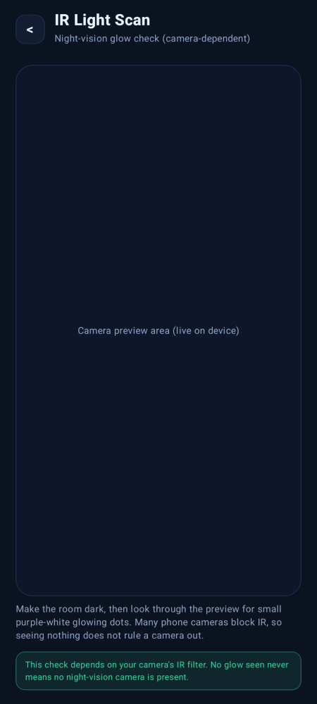 | 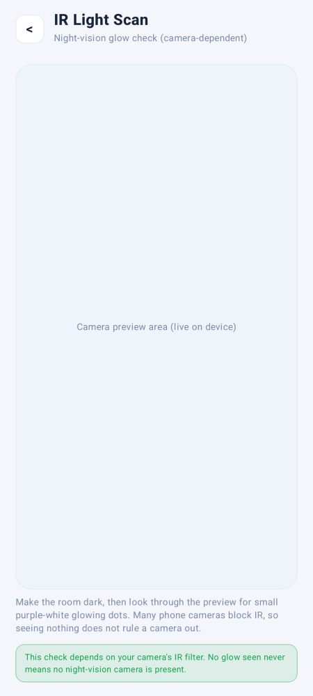 |
| Wi-Fi Devices | 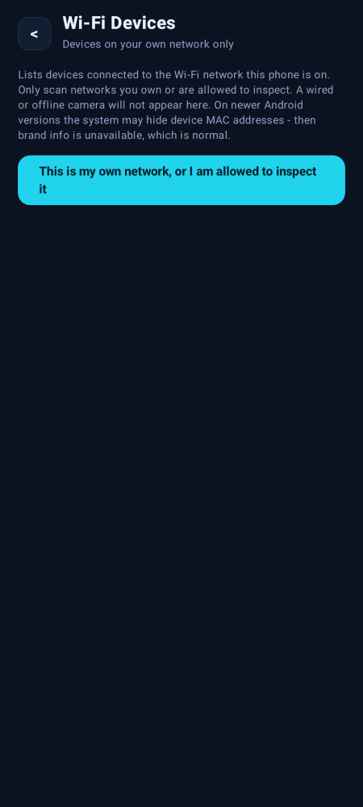 | 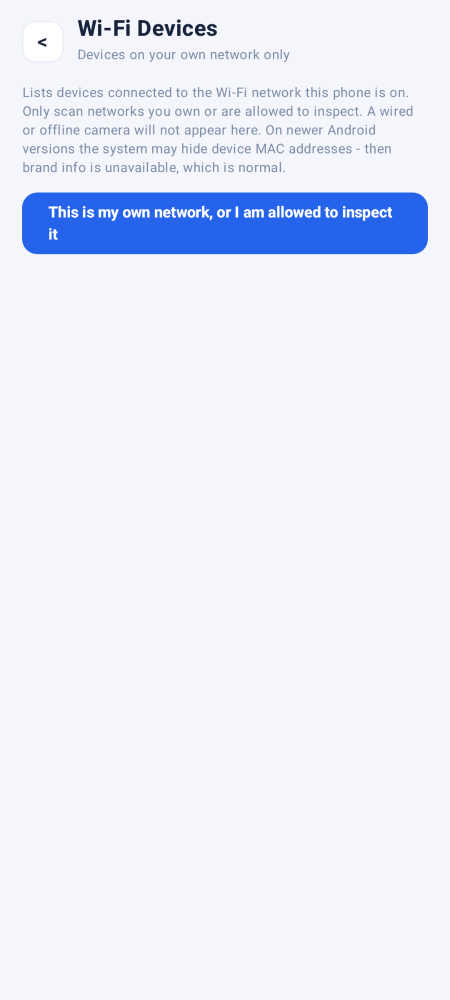 |
| Magnetic Sensor | 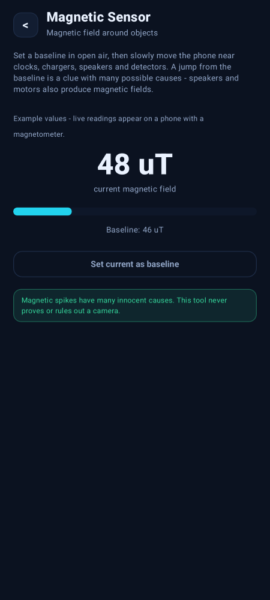 | 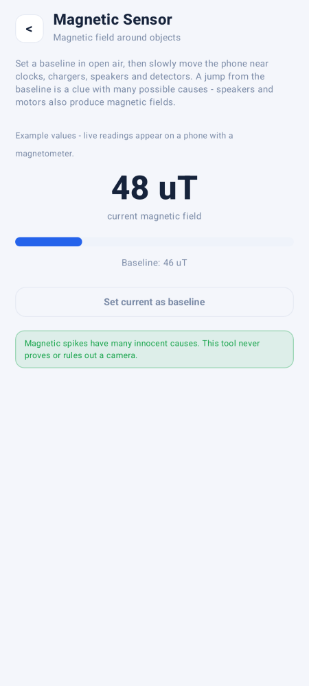 |
| Report | 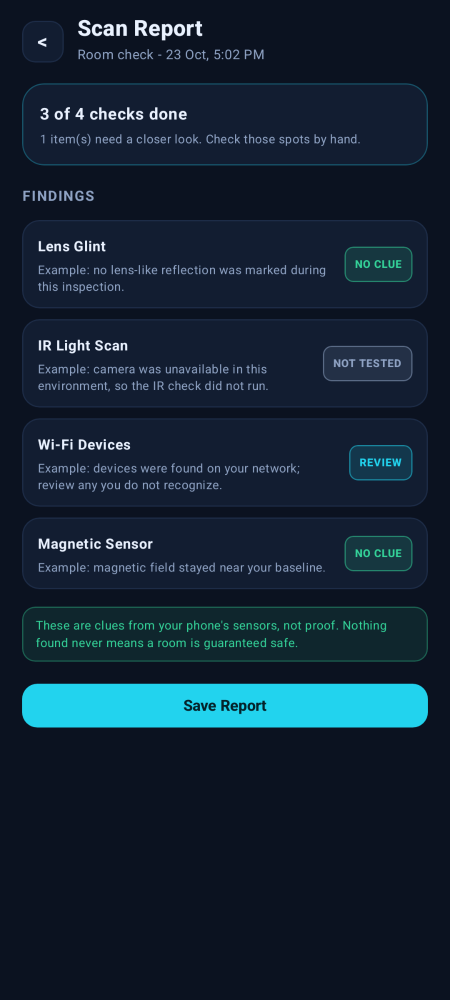 | 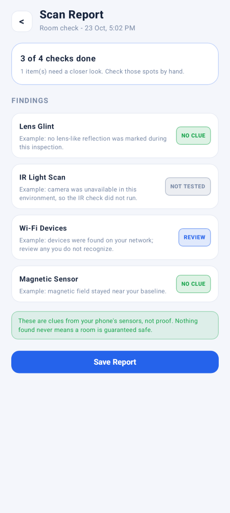 |
| History | 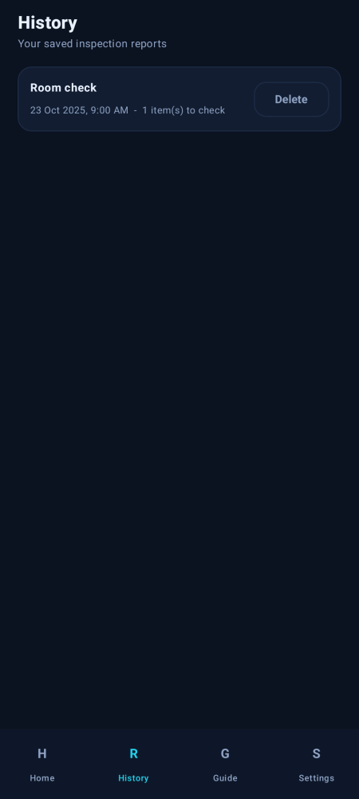 | 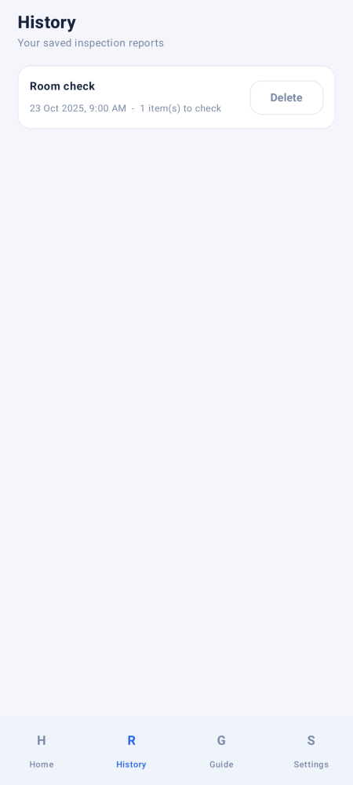 |
| Guide | 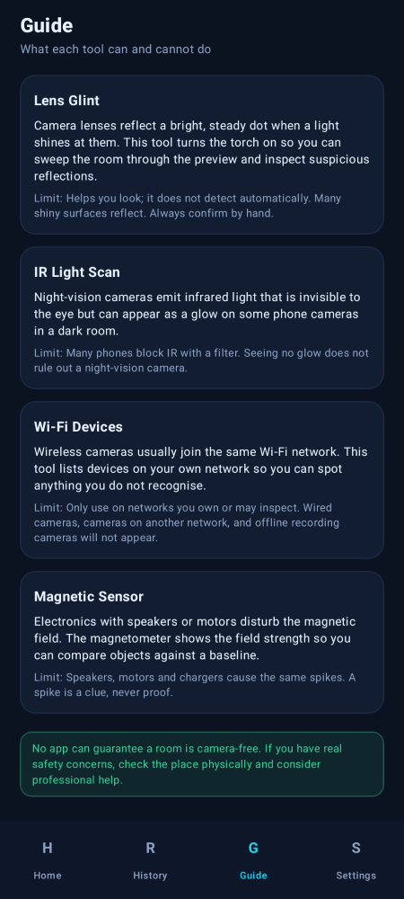 | 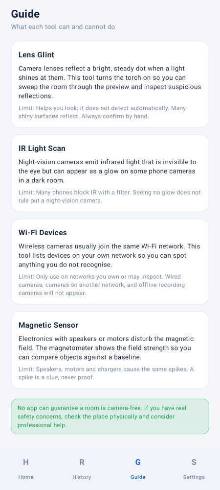 |
| Settings | 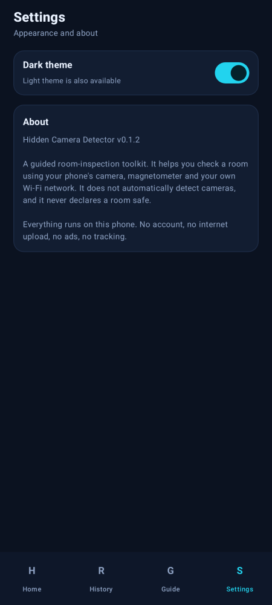 | 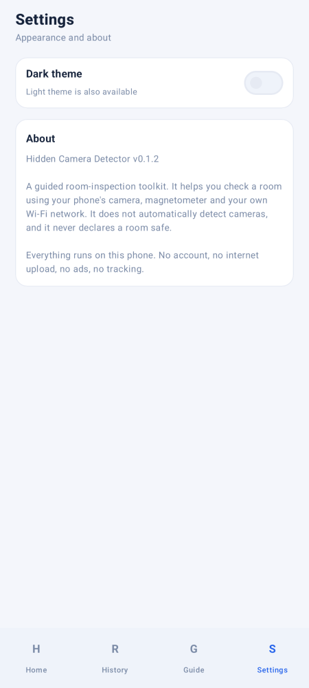 |
